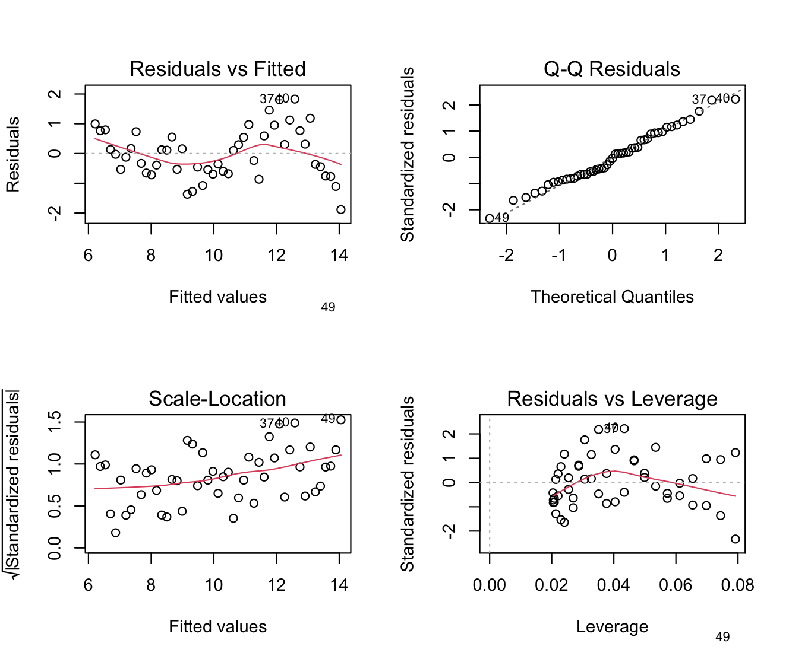

# California Crop Acreage: Trends and Regression Diagnostics

**Fredrick Osei · STAT 601 Practicum, Parts 1–3 · Iowa State University**

A three-part R course project examining annual California crop acreage from **1960–2008**: linear trend diagnostics, nonlinear and AR(1) models, and compositional modeling of crop proportions.

**[Part 1 report](STAT_601.pdf)** · **[Part 2: nonlinear trends and AR(1) models](part2/README.md)** · **[Part 2 report](part2/STAT_601_Part2.pdf)** · **[Part 3 report](part3/STAT_601_Part3.pdf)**

## Project parts

- **Part 1:** linear trends and regression diagnostics, with a verified base-R runner.
- **[Part 2](part2/README.md):** Gompertz growth curves, linear trends with AR(1) errors, autocorrelation diagnostics, and exploratory composite likelihood/bootstrap code. The Gompertz and full AR(1) fits have been reproduced; composite-likelihood and bootstrap limitations are documented separately.

- **[Part 3 — final part](part3/README.md):** crop proportions, compositional modeling, and a report on Dirichlet regression and diagnostics. The initial four-parameter script section runs; the full reported Dirichlet analysis is not reproduced by the supplied code.

## Part 1 research question

How well does a linear time trend describe fruit and vegetable acreage, and what do model diagnostics reveal about its limitations?

There are 49 annual observations for each of three supplied series: fruit, vegetables, and other crops. The regression analyses focus on fruit and vegetables. The other-crop series is used to calculate acreage proportions.

## Methods

- Scale acreage into units of 100,000 acres.
- Define a time index, `zt = year - 1959`.
- Fit separate ordinary least squares models: `acres ~ zt`.
- Examine time trends, fitted lines, residuals, Q–Q plots, scale-location plots, and leverage diagnostics.
- Prepare fruit, vegetable, and other-crop proportions for subsequent work.

## Part 1 results

The following values were reproduced by running the supplied script on the included data:

| Crop | Intercept | Slope per year (100,000 acres) | Adjusted R² |
| --- | ---: | ---: | ---: |
| Vegetables | 6.049701 | 0.163386 | 0.884464 |
| Fruit | 11.121971 | 0.293668 | 0.982567 |

Both fitted slopes are positive. However, the residual patterns suggest that a straight line does not capture the full relationship over time. The report discusses polynomial regression, transformations, and more flexible modeling as possible extensions. These extensions are **not fitted in this Part 1 script**.

### Fruit acreage over time


### Vegetable regression diagnostics



The images above are the supplied project figures. Running the analysis also creates a PDF of plots.

## Run the analysis

For **Part 1**, only **R and its standard packages** are required; no additional packages need installation. Parts 2 and 3 have [separate Part 2 instructions](part2/README.md) and [Part 3 instructions](part3/README.md).

Download or clone the repository. Open a terminal in the project folder and run:

```sh
Rscript --vanilla run.R
```

Alternatively, set the R working directory to the project folder and run:

```r
source("run.R")
```

The runner executes the original script in a temporary working directory and saves:

| Output | Contents |
| --- | --- |
| `outputs/model-summaries.txt` | Full regression summaries |
| `outputs/model-metrics.csv` | Coefficients and adjusted R² |
| `outputs/analysis-plots.pdf` | Plots produced by the original script |
| `outputs/data.p3.csv` | Regenerated crop proportions |
| `outputs/vegnew.csv` | Vegetable export generated by the original script |
| `outputs/session-info.txt` | R version and session information |

The runner preserves the supplied inputs and CSV files. It replaces its own outputs on later runs.

## Files

| File or folder | Purpose |
| --- | --- |
| `STAT_601.pdf` | Original Part 1 report |
| `part1 script.R` | Original R analysis, unchanged |
| `run.R` | Runner that checks inputs and saves outputs |
| `CAfruitdat.txt` | Annual fruit acreage |
| `CAvegetabledat.txt` | Annual vegetable acreage |
| `CAothercropdat.txt` | Annual other-crop acreage |
| `fruitnew.csv`, `vegnew.csv` | Supplied scaled data exports |
| `data.p3.csv` | Supplied crop proportions |
| `figfruit/`, `figveg/` | Original PNG figures |
| `REPRODUCIBILITY.md` | Part 1 validation details and file conventions |
| `part2/` | Part 2 report, pipeline, data, figures, runner, and review notes |
| `part3/` | Final report, compositional data, original script, figures, limited runner, and review notes |

## Scope and interpretation

This repository contains **all three parts** of the practicum. The linear-regression results above describe Part 1; see the Part 2 and Part 3 folders for their results and limitations. A high R² alone does not establish that model assumptions hold. Annual observations may be serially dependent; the supplied script does not test or model that dependence. The fitted slopes describe time associations, not causal effects. Within-year seasonality cannot be assessed using one observation per year.

The original data-provider citation is not identified in the supplied report or script. The included text files are the course-project inputs; no independent data-source attribution is claimed here.

## Author

[Fredrick Osei](https://foseistats.github.io/) · [GitHub](https://github.com/foseistats) · [LinkedIn](https://www.linkedin.com/in/fredrick-osei-ms-813837224)
