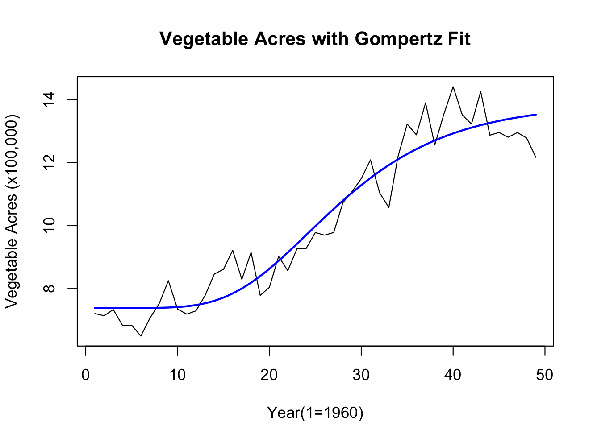
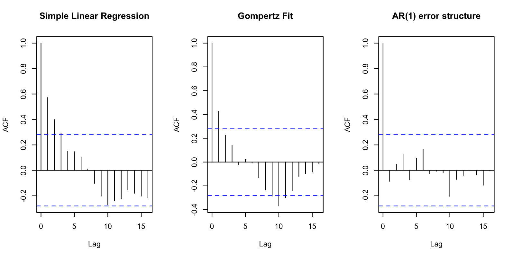

# Part 2: Nonlinear Trends and Autocorrelated Errors

**STAT 601 Practicum · Fredrick Osei**

**[Read the Part 2 report](STAT_601_Part2.pdf)** · [Back to the full project](../README.md)

Part 2 builds on the linear-trend diagnostics in Part 1. It fits a Gompertz curve to vegetable acreage, estimates linear trends with stationary Gaussian AR(1) errors for both crops, compares autocorrelation diagnostics, and explores pairwise composite likelihood with parametric bootstrap intervals.

## Verified fits

The original targets pipeline runs from the included CSV files. Its Gompertz coefficients are approximately `alpha0 = 7.38487`, `alpha1 = 6.48041`, `beta = 2.85521`, and `gamma = 0.11780`.

| AR(1) model | Intercept | Slope | AR coefficient | Innovation variance |
| --- | ---: | ---: | ---: | ---: |
| Vegetables | 6.318565 | 0.151350 | 0.655648 | 0.418739 |
| Fruit | 11.458395 | 0.281751 | 0.895053 | 0.057789 |

These coefficients agree with the rounded report values. The composite-likelihood estimates and bootstrap intervals have **not** been reproduced from a complete clean-session workflow; see [review notes](REPRODUCIBILITY.md).

## Figures from the original project





Additional supplied PNGs show residual comparisons and AR(1) trend lines for each crop.

## Run

From R, install the packages used by the targets pipeline once:

```r
install.packages(c("targets", "tibble", "ggplot2", "dplyr"))
```

Then, from the repository root in a terminal:

```sh
cd part2
Rscript --vanilla run.R
```

The added runner builds the original pipeline and saves summaries, AR(1) estimates, plots, and R session information under `part2/outputs/`. Its generated ACF plot uses current estimates and standardizes the first AR(1) error; the supplied original PNG is preserved separately. The runner does not execute the exploratory bootstrap scripts. Additional packages referenced by those scripts include `mvtnorm` and `gridExtra`.

## Files

- `_targets.R`, `functions.R`: original pipeline and model functions, unchanged.
- `run.R`: added runner and result export.
- `results.call.R`: original interactive result and plotting commands.
- `compositeLscript.R`, `others.R`, `part2codesscript`: original exploratory code; review notes explain their dependencies and limitations. The extensionless file contains R code.
- `fruitnew.csv`, `vegnew.csv`: scaled model inputs, including `zt`.
- `CA*dat.txt`: supplied raw acreage files.
- `601 practicum part 2.Rproj`: optional original RStudio project file.
- `STAT_601_Part2.pdf`: original report, renamed for clarity.
- Five PNG files: supplied figures.

The saved `601p2objects.RData` workspace and `_targets/` cache are omitted. The pipeline rebuilds its own cache from source and inputs.
