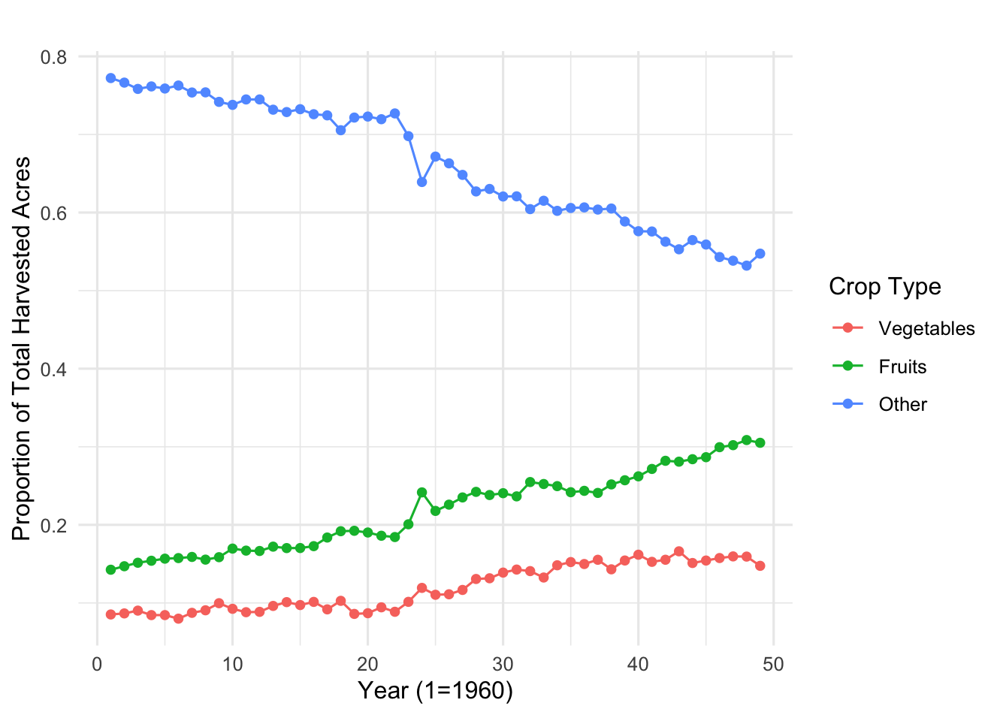
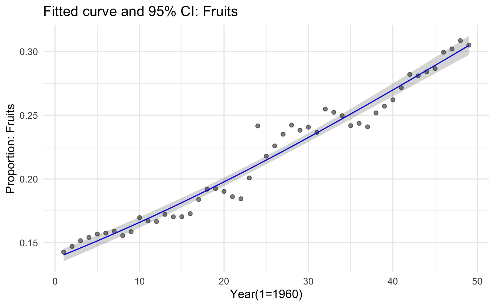
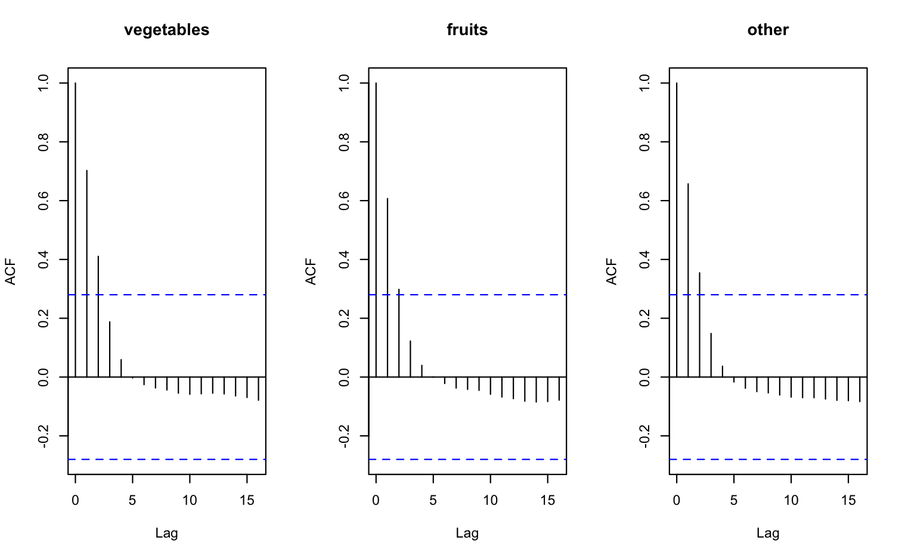

# Part 3: Crop Proportions and Compositional Modeling

**STAT 601 Practicum · Fredrick Osei · Final part**

**[Read the Part 3 report](STAT_601_Part3.pdf)** · [Full project](../README.md)

Part 3 shifts from acreage levels to the proportions of harvested acreage allocated to vegetables, fruit, and other crops. The report explores Dirichlet modeling, fitted mean curves, confidence bands, precision, and residual diagnostics for these three components, which sum to one each year.

## Data and patterns

The 49 observations cover 1960–2008, with `zt = 1` corresponding to 1960. Columns `yv`, `yf`, and `yo` contain vegetable, fruit, and other-crop proportions. The supplied CSV matches the proportions prepared in Part 1.



Fruit and vegetable shares generally increase over the period, while the other-crop share decreases.

## Report and code status

The report discusses a Dirichlet model and displays parameter estimates, confidence intervals, and Beta-marginal diagnostics. The supplied script implements a different, four-parameter proportion-weighted log objective, followed by incomplete diagnostic code. **A full Dirichlet fit, its precision parameter, confidence bands, and K–S results have not been reproduced from this script.**

The self-contained initial fit runs with convergence code 0. Its coefficients are approximately:

| Parameter | Reproduced estimate |
| --- | ---: |
| Vegetable intercept | -2.482831 |
| Vegetable time slope | 0.018352 |
| Fruit intercept | -1.818889 |
| Fruit time slope | 0.020570 |

These describe the original script's objective and should not be labeled reproduced Dirichlet regression estimates. The [reproduction notes](REPRODUCIBILITY.md) explain the distinction.

## Supplied figures





These are preserved figures from the supplied project, not results regenerated by the added runner. Other PNGs include the three fitted curves, residual scatterplots, and PACF plots.

## Run the verified portion

Install the plotting/data-reshaping dependencies once:

```r
install.packages(c("ggplot2", "tidyr"))
```

From the repository root, run:

```sh
cd part3
Rscript --vanilla run.R
```

The runner executes the initial fitting section of the unchanged original script. It validates the proportions, exports the four fitted coefficients and fitted proportions, saves the initial section's plots as a PDF, and records the R session in `outputs/`. It omits the later incomplete residual and Beta-marginal diagnostic sections and does not generate confidence intervals or a precision estimate.

## Contents

- `part3codes.R`: original R script, unchanged.
- `run.R`: added runner for the verified initial section.
- `data.p3.csv`: supplied compositional data.
- `STAT_601_Part3.pdf`: original report, renamed for clarity.
- `601 practicum part 3.Rproj`: optional original RStudio project file.
- Eleven PNG files: original supplied figures, unchanged.
- `REPRODUCIBILITY.md`: execution status and code/report differences.

The project is complete as a collection of the three submitted parts; the documented reproduction limitations remain relevant when using or extending the analysis.
